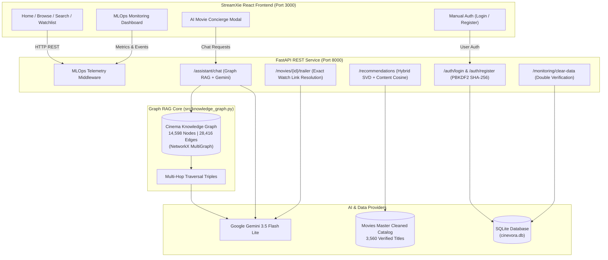

# Cinevora — Real-Time Movie Recommendation Service with Knowledge Graph RAG & MLOps Monitoring

[](https://fastapi.tiangolo.com)
[](https://react.dev)
[](https://www.typescriptlang.org)
[](https://vitejs.dev)
[](https://ai.google.dev)
[](https://networkx.org)
[](https://tailwindcss.com)
[](https://sqlite.org)
[](https://www.python.org)

**Cinevora** is an enterprise-grade, full-stack cinema discovery and intelligence platform. It fuses **Graph RAG (Knowledge Graph Augmented Generation)** with **Google Gemini 3.5 Flash Lite**, **classical hybrid machine learning (SVD matrix factorization + genre cosine similarity)**, real-time **MLOps telemetry monitoring**, and a **StreamXie cinematic UI** built with React, Vite, and Tailwind CSS.

The service is fully grounded in a verified **3,560-title master catalog** spanning Indian Cinema (**Tamil, Bollywood, Telugu, Malayalam, Kannada**) and **Hollywood**.

---

## 🌟 Key Highlights & Innovations

1. **🕸️ Graph RAG (Cinema Knowledge Graph)**
   - In-memory heterogeneous graph containing **14,598 nodes** and **28,416 edges** across movies, actors, directors, genres, industries, and cinematic universes.
   - **5 Multi-Hop Relational Strategies**:
     - `universe_traversal`: Traverses shared cinematic universes (e.g., *Lokesh Cinematic Universe / LCU*, *YRF Spy Universe*, *Cop Universe*, *KGF Realm*).
     - `collaboration_bridge`: Connects actor-director pairs (e.g., *Shah Rukh Khan + Atlee $\rightarrow$ Jawan*).
     - `multi_hop_relational`: 2-hop graph walk connecting films via shared cast, director, and genre synergy.
     - `director_ecosystem` & `actor_filmography`: Subgraph expansions ranked by degree centrality and catalog ratings.
   - Grounded reasoning triples passed to **Gemini 3.5 Flash Lite** for factual, explainable movie recommendations.

2. **🎬 On-the-Fly YouTube Trailer Resolution**
   - Resolves exact 11-character YouTube trailer watch links (`https://www.youtube.com/watch?v=VIDEO_ID`) dynamically via Gemini for missing or query fallback links.
   - Inline iframe player with `✨ Gemini Resolved` badge and responsive modal controls.

3. **🔐 Manual SQLite User Authentication**
   - Real, persistent user accounts stored in SQLite with salted **PBKDF2-HMAC-SHA256** password hashing.
   - Manual user registration (`/register`) and login (`/login`) pages with instant session synchronization.
   - User profile switcher supporting custom accounts and built-in demo personas (Alex, Sarah, Dev Mode).

4. **📊 Real-Time MLOps Telemetry & Double-Verification Purge**
   - Microsecond latency tracking (`time.perf_counter()`), percentile distributions ($p_{50}, p_{95}$), throughput, error rates, and recommendation conversion rates.
   - **Double-Verification Data Purge**: Destructive audit cleanup requiring exact `CLEAR_ALL_DATA` string confirmation and checkbox acknowledgment. Preserves user accounts and database table schemas.

5. **🍿 StreamXie Cinematic Frontend**
   - Hero banner with auto-rotating featured films and one-click trailer modals.
   - Filterable carousels: *Trending Today*, *Kollywood & Tamil Hits*, *Bollywood Blockbusters*, *Tollywood Showcase*, *Hollywood & International*, and *Recommended for You*.
   - Instant search modal (`Cmd+K` / `Ctrl+K`) with live query suggestions and genre pills.

---

## 🏛️ System Architecture



---

## 📁 Repository Structure

```
cinevora/
├── app/
│   ├── main.py                     # FastAPI REST server & routing
│   ├── assistant.py                # Gemini AI Assistant & Graph RAG coordinator
│   ├── config.py                   # Pydantic Settings & environment variables
│   ├── db.py                       # SQLite schema, interactions, and telemetry logs
│   └── schemas.py                  # Pydantic v2 strict request/response models
├── src/
│   ├── knowledge_graph.py          # Heterogeneous Cinema Knowledge Graph (NetworkX)
│   ├── recommender.py              # Hybrid SVD + Content Cosine recommendation algorithms
│   ├── catalog_service.py          # Master catalog loading, queries, and filters
│   └── retrieval_service.py        # Strict entity validation and search execution
├── frontend_ui/                    # StreamXie React / TypeScript Frontend
│   ├── src/
│   │   ├── components/             # Navbar, HeroBanner, ContentCarousel, TrailerModal, etc.
│   │   ├── pages/                  # HomePage, BrowsePage, MovieDetailPage, MonitoringPage, LoginPage
│   │   ├── lib/cinevoraClient.ts   # Unified API adapter connecting UI to FastAPI backend
│   │   └── hooks/                  # use-auth, useDocumentMeta, etc.
│   ├── package.json
│   ├── vite.config.ts
│   └── Dockerfile
├── data/
│   └── processed/
│       └── Movies_Master_Cleaned.csv # 3,560-title verified master catalog
├── scripts/
│   ├── enrich_trailers_with_gemini.py # Batch Gemini trailer watch link enrichment
│   └── test_graph_rag.py           # Multi-hop retrieval benchmark script
├── Dockerfile                      # Production backend container definition
├── docker-compose.yml              # Multi-container full-stack composition
├── requirements.txt                # Python backend dependencies
└── README.md
```

---

## 🚀 Quickstart & Local Setup

### Prerequisites
- **Python 3.10+** (Tested on Python 3.11, 3.12, 3.14)
- **Node.js 18+** & **npm**
- **Google Gemini API Key** (Free tier available at [Google AI Studio](https://aistudio.google.com/))

### 1. Clone the Repository
```bash
git clone https://github.com/manikandan10bs/cinevora.git
cd cinevora
```

### 2. Configure Environment Variables
Create a `.env` file in the project root:
```ini
GEMINI_API_KEY=your_actual_gemini_api_key_here
GEMINI_MODEL=gemini-3.5-flash-lite
APP_HOST=127.0.0.1
APP_PORT=8000
CINEVORA_API_URL=http://127.0.0.1:8000
```

### 3. Setup Backend (Python)
```bash
# Create and activate virtual environment
python -m venv .venv

# Windows PowerShell:
.\.venv\Scripts\Activate.ps1
# macOS / Linux:
source .venv/bin/activate

# Install dependencies
pip install -r requirements.txt

# Start FastAPI backend
python -m uvicorn app.main:app --host 127.0.0.1 --port 8000 --reload
```
*Backend runs on `http://127.0.0.1:8000`. API Docs available at `http://127.0.0.1:8000/docs`.*

### 4. Setup Frontend (React / Vite)
Open a new terminal:
```bash
cd frontend_ui

# Install dependencies
npm install

# Start Vite development server
npm run dev
# Or build and preview production build:
npm run build && npm run preview -- --port 3000
```
*Frontend runs on `http://localhost:3000`.*

---

## 🐳 Docker Deployment

Run the complete full-stack platform using Docker Compose:

```bash
# Build and run containers
docker-compose up --build
```

- **Backend API**: `http://localhost:8000`
- **StreamXie UI**: `http://localhost:3000`

---

## ☁️ Cloud Deployment Guide

### Deploy Frontend to Vercel
1. Install Vercel CLI: `npm i -g vercel`
2. Navigate to `frontend_ui`:
   ```bash
   cd frontend_ui
   vercel
   ```
3. Set the environment variable in Vercel project settings:
   - `VITE_API_BASE_URL`: URL of your deployed FastAPI backend (e.g. `https://cinevora-api.onrender.com`).

### Deploy Backend to Render / Railway / Fly.io
1. **Render**:
   - Create a new **Web Service** pointing to your GitHub repository.
   - **Runtime**: Python 3.
   - **Build Command**: `pip install -r requirements.txt`
   - **Start Command**: `uvicorn app.main:app --host 0.0.0.0 --port $PORT`
   - **Environment Variables**:
     - `GEMINI_API_KEY`: Your Gemini API key.
     - `GEMINI_MODEL`: `gemini-3.5-flash-lite`.

---

## 🧪 Testing & Verification

Run automated test suites with pytest:
```bash
pytest tests/ -v
```

Test the Graph RAG engine directly:
```bash
python scripts/test_graph_rag.py
```

---

## 👤 Author & Contact

- **Author**: Manikandan N
- **Email**: [manikandan10bs@gmail.com](mailto:manikandan10bs@gmail.com)
- **Repository**: [https://github.com/manikandan10bs/cinevora](https://github.com/manikandan10bs/cinevora)

---

## 📄 License
This project is licensed under the MIT License. See [LICENSE](LICENSE) for details.
